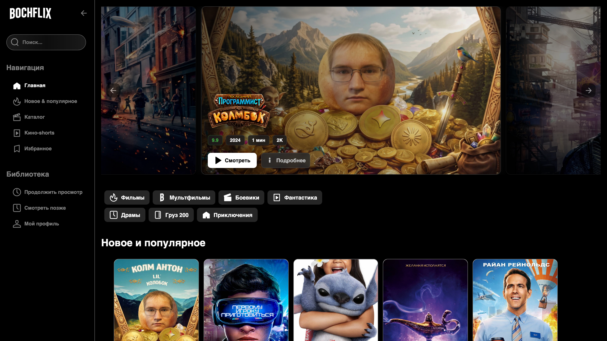
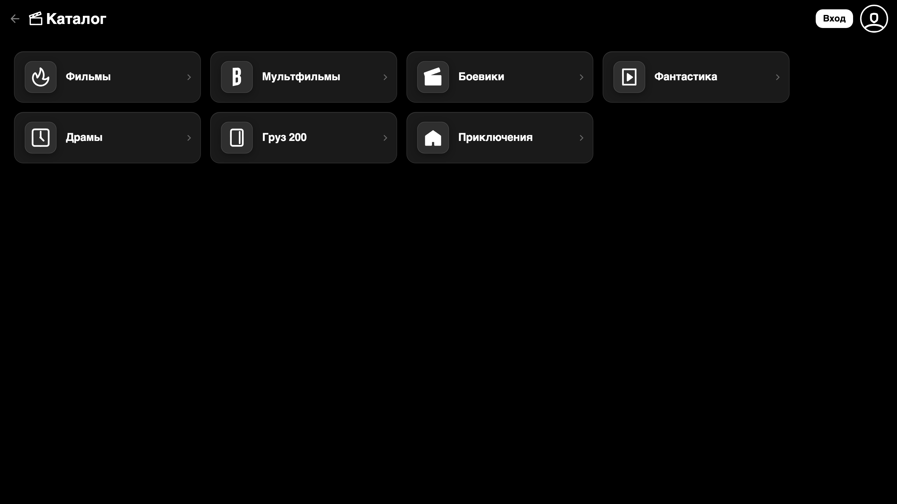
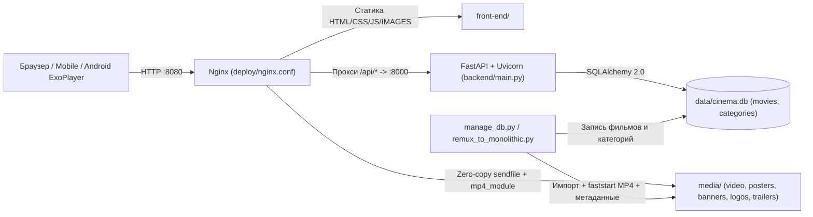

# 🎬 Bochflix

**Bochflix** — локальный и сетевой веб-кинохостинг с адаптивным интерфейсом, потоковым вещанием видео через Nginx (`ngx_http_mp4_module`, `Range`-запросы), REST API на **FastAPI** и встроенной CLI-утилитой для управления медиатекой и автоматического извлечения метаданных видеофайлов.

---

## 📸 Скриншоты интерфейса

> Поместите готовые скриншоты в папку `screenshots/` (ссылки ниже подключатся автоматически):

| Главная страница и промо-слайдер | Каталог фильмов и категории |
| :---: | :---: |
|  |  |

| Страница фильма и плеер | Swagger UI (REST API) |
| :---: | :---: |
|  |  |

---

## 🏗 Схема структуры проекта

### Архитектура взаимодействия сервисов



### Дерево каталогов

```text
gemini-project-2/
├── backend/                        # Бэкенд на FastAPI
│   ├── main.py                     # Точка входа FastAPI, CORS, статика в dev, /health
│   ├── config.py                   # Настройки Pydantic BaseSettings (.env, пути, CORS, порт 8000)
│   ├── database.py                 # Подключение SQLAlchemy, авто-миграции, seed_default_data
│   ├── models.py                   # ORM-модели Category и Movie (строго 2 таблицы)
│   ├── schemas.py                  # Pydantic-схемы и транслитерация slugify
│   ├── routes/
│   │   └── movies.py               # REST API: категории, фильмы, баннеры, CRUD
│   └── utils/
│       ├── pnr.py                  # Генератор и валидатор 6-значного PNR
│       ├── category_parser.py      # Отказоустойчивый парсер category_ids
│       └── video_meta.py           # Извлечение длительности и разрешения видео
├── front-end/                      # Клиентская часть (Vanilla JS, HTML5, CSS3)
│   ├── HTML/                       # index.html, catalog.html, information.html, error.html
│   ├── JS/                         # frontend_loader.js, script.js, catalog.js, information.js
│   ├── STYLES/                     # style.css, catalog.css, informaton.css, optimize.css, reset.css
│   ├── IMAGES/                     # Иконки, логотипы и fallback-изображения
│   └── FONTS/                      # Локальные шрифты
├── deploy/
│   ├── nginx.conf                  # Конфигурация Nginx (:8080) для API, статики и MP4-стриминга
│   └── snippets/                   # Включаемые CORS-заголовки
├── data/
│   └── cinema.db                   # База данных SQLite
├── media/                          # Медиахранилище (video/, posters/, banners/, logos/, trailers/, icons/)
├── tests/
│   └── test_backend.py             # Автотесты API и утилит (pytest)
├── manage_db.py                    # Интерактивная CLI-утилита наполнения и управления БД
├── remux_to_monolithic.py          # Проверка и перепаковка fMP4 -> монолитный faststart MP4
├── migrate_schema.py               # Скрипт миграции схемы БД
├── run_server.py                   # Запуск Uvicorn-сервера
├── start_servers.sh                # Запуск Nginx (:8080) и FastAPI (:8000)
├── stop_servers.sh                 # Остановка сервисов
├── restart_servers.sh              # Перезапуск сервисов
├── requirements.txt                # Python-зависимости
└── .env.example                    # Шаблон переменных окружения
```

---

## ⚙️ Описание бэкенда

Бэкенд построен на **FastAPI** + **SQLAlchemy 2.0** + **SQLite** и работает на порту `8000` (в продакшене и локальной сети закрыт обратным прокси **Nginx** на порту `8080`).

### 1. Стек технологий
- **FastAPI** и **Uvicorn** — асинхронный веб-сервер и автогенерация OpenAPI/Swagger (`/docs`, `/redoc`).
- **SQLAlchemy 2.0** + **SQLite** — ORM и встроенная БД (`data/cinema.db`) с автоматической миграцией при старте (`lifespan` -> `init_db()`).
- **Pydantic v2** и **pydantic-settings** — строгая валидация запросов/ответов и загрузка конфигурации из `.env`.
- **OpenCV / Mutagen / ISO-MP4 Atom Parser** — многоуровневое извлечение разрешения (`HD`, `FHD`, `2K`, `4K`) и длительности (`X ч Y мин`) из видеофайлов.

### 2. Архитектура базы данных (2 таблицы)
В проекте используется упрощённая схема строго из **2 таблиц** без промежуточных M2M-таблиц:
- **`categories`** — категории каталога (`id`, `name`, `slug`, `icon_path` с автоматическим fallback на стандартную иконку `resolve_icon_url`).
- **`movies`** — фильмы (`id`, `pnr`, `title`, `description`, `plot`, `duration`, `quality`, `poster_url`, `banner`, `mobile_poster`, `movie_page_url`, `logo_url`, `trailer`, `is_hero_banner`, `category_tag`, `category_ids`, `rating`).
  - **`pnr`** — уникальный 6-символьный идентификатор фильма (`0-9` и заглавные согласные `BCDFGHJKLMNPQRSTVWXYZ`, без гласных), генерируется через `secrets`.
  - **`category_ids`** — список ID категорий через запятую (например, `"1,4,6"`). Парсер `category_parser.py` валидирует значения и при повреждении строки безопасно пропускает запись без 500-ошибок.
  - **`category_tag`** — системный статус (`none`, `new`, `popular`, `new_popular`), заменяющий отдельные булевы колонки (при этом в модели сохранены `@hybrid_property` для обратной совместимости).

### 3. Основные эндпоинты API (`/api` и `/api/v1`)

| Метод | Эндпоинт | Назначение |
| :--- | :--- | :--- |
| `GET` | `/health` | Проверка работоспособности сервиса |
| `GET` | `/api/v1/catalog/categories` | Список категорий с иконками (по умолчанию скрывает пустые; `include_empty=true` показывает все) |
| `GET` | `/api/v1/categories` | Непустые категории с вложенными фильмами и пагинацией (`offset`, `limit`) для Infinite Scroll |
| `POST` | `/api/v1/categories` | Создание категории с транслитерацией `slug` и проверкой дубликатов |
| `GET` | `/api/v1/movies` | Список фильмов с фильтрацией по `category_id`, `category_slug`, `category_tag`, `is_popular` |
| `GET` | `/api/v1/movies/{identifier}` | Детальная карточка фильма по числовому `id` или 6-значному `pnr` |
| `POST` | `/api/v1/movies` | Добавление фильма с автогенерацией `pnr` и автосозданием категорий |
| `DELETE` | `/api/v1/movies/{pnr}` | Удаление фильма по `pnr` |
| `GET` | `/api/v1/banners` | Фильмы для главного промо-слайдера (`is_hero_banner = True`) |

### 4. CLI-управление и обработка видео
- **`manage_db.py`** — пошаговый интерактивный мастер добавления фильмов: генерация `PNR`, автопарсинг метаданных видео (`video_meta.py`), проверка фрагментации MP4 и склейка/оптимизация `moov` в начало файла (`faststart` через `remux_to_monolithic.py`), перенос медиафайлов в `media/` по шаблонам `<PNR>_poster`, `<PNR>_desktop`, `<PNR>_mobile`, `<PNR>_logo`, `<PNR>_trailer`.
- **`deploy/nginx.conf`** — раздача статики `front-end/`, проксирование `/api/` на `127.0.0.1:8000` и zero-copy стриминг видео `/movie/video/` с поддержкой `mp4` псевдостриминга и `Accept-Ranges: bytes`.

---

## 🚀 Быстрый запуск

```bash
# 1. Создать виртуальное окружение и установить зависимости
python3 -m venv .venv
source .venv/bin/activate
pip install -r requirements.txt

# 2. Запустить Nginx (:8080) и FastAPI (:8000)
./start_servers.sh

# 3. Открыть в браузере
# Сайт:       http://localhost:8080
# Swagger UI: http://127.0.0.1:8000/docs

# 4. Запуск автотестов
pytest
```

## Скрипт для загрузки фильмов в БД
(Временно, пока я не добавлю механику загрузки напрямую через фронт)

```bash
python3 manage_db.py
```

Он позволяет внести все данные о фильме и пересобирает MP4 в монолитный формат, если файл оказался фрагментарным (т.к. nginx  в стоке не поддерживает передачу фрагментарных MP4)
Преобразовать файлы можно и самостоятельно: напрямую вызвав скрипт `remux_to_monolithic.py`

```bash
# 1. Проверить статус всех файлов в папке media (без изменений):
.venv/bin/python remux_to_monolithic.py --check-only

# 2. Перепаковать конкретный файл:
.venv/bin/python remux_to_monolithic.py media/video/Y8967C.mp4

# 3. Автоматически найти и перепаковать все немонолитные файлы в media:
.venv/bin/python remux_to_monolithic.py media
```

## Предварительные требования к системе рекомендаций
### Файловая структура <span style="color: red;">Вот это прям обязательная фигня, собачка</span>
Реализуй модульную архитектуру: вынеси отдельные функции, логику и модели поведения во вспомогательные файлы, а в главном файле импортируй их и собирай итоговую структуру рекомендаций. Сам скрипт я планирую вызывать в файле `movies.py` (Он расположен по пути: `~/backend/routes/movies.py`)
### Формат ответа (API Response)
Строгого ТЗ по структуре ответа нет — предложи свой оптимальный вариант (например, JSON). Главное требование: ответ должен содержать списки PNR-идентификаторов фильмов с привязкой к категориям для корректного рендеринга на фронтенде.
